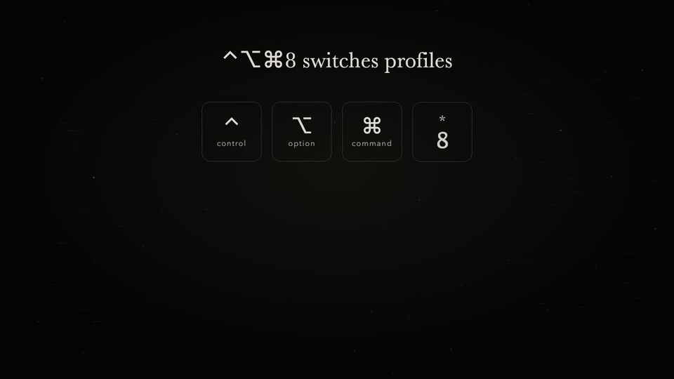
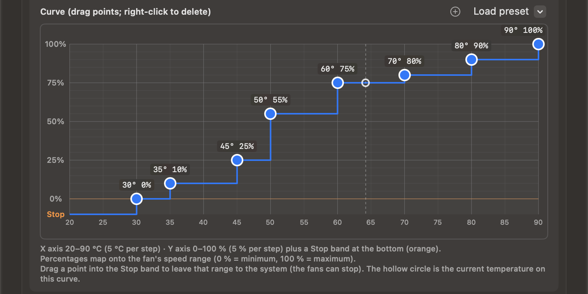
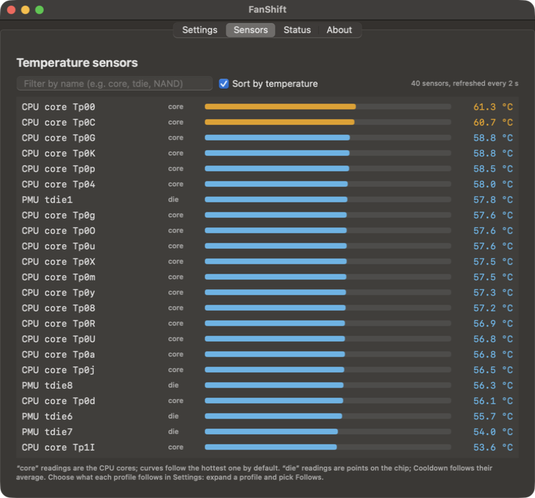

# FanShift

[English](README.md) | [中文](README.zh.md)

一个 macOS 菜单栏 App：用一个全局快捷键在几个命名的风扇档位之间循环切换。每个档位是一条「温度 → 风扇转速」曲线，在图上拖点编辑。FanShift 通过 SMC 直接控制风扇，不需要别的风扇软件。

<p align="center"></p>

<p align="center"><b><a href="https://github.com/KrisWonka/FanShift/releases/latest">下载 FanShift</a></b> · Apple 芯片 · macOS 14 或更新 · 免费开源</p>

> 目前只在一台机器上测过：M5 Pro 的 MacBook Pro（Mac17,9），macOS 27。M1–M4 的支持已经写了，但没测过。见[兼容性](#兼容性)。

## 功能

- **全局快捷键**（默认 `⌃⌥⌘8`，可以改）。每按一次切到下一档，屏幕中央弹出档位名。不需要辅助功能权限。
- **菜单栏读数**：档位字母、温度、风扇转速。左键切下一档；右键出菜单，可以直接选档位、打开设置、退出。
  - 两种排法：一行（`P 52° 5330`），或者叠成两行小字（转速在温度上面，也可以反过来）。
  - 档位字母可以分出去单独一个菜单栏图标：点字母切档，点读数出菜单。
  - 可以再显示第二个温度；温度高时可以变色（85 °C 起橙色，95 °C 起红色）。
- **四种档位**
  - **Auto**：FanShift 不碰风扇，完全由系统控制，空闲时风扇可以停转。
  - **Temperature**：按曲线调速。自带 Silence、Performance、Turbo 三条预设曲线。
  - **Full Blast**：全速，可以设一个定时（1–60 分钟），到点把风扇交还系统。
  - **Cooldown**：全速，直到芯片平均温度降到目标值以下，然后把风扇交还系统。
- **曲线编辑器**：在 5 °C / 5 % 的格子上拖点，右键删除一个点，把点拖进 Stop 区表示这一段温度交给系统。图上有一个标记显示当前温度落在曲线的哪个位置。

  
- **Sensors 页**列出所有温度传感器，每 2 秒刷新。

  

- 重启后恢复上次的档位；可以设成登录时自动启动。
- 界面有英文、简体中文、繁体中文、西班牙文四种，在设置页最上面切换（默认英文）。

## 安装

1. 从 [Releases](https://github.com/KrisWonka/FanShift/releases/latest) 下载 `FanShift-0.1.0.zip`，解压后把 `FanShift.app` 拖进「应用程序」。
2. 打开它。FanShift 还没经过 Apple 公证，第一次打开会被系统拦下：打开「系统设置 → 隐私与安全性」，往下翻，点「仍要打开」。也可以在终端里跑：

   ```bash
   xattr -dr com.apple.quarantine /Applications/FanShift.app
   ```

3. 第一次启动时 FanShift 会要求安装它的后台程序，需要输一次管理员密码。

### 从源码编译

要先装好 Xcode 命令行工具（Swift 5.9 或更新）。

```bash
git clone https://github.com/KrisWonka/FanShift.git
cd FanShift
bash scripts/build-app.sh --install
```

这会编译 App、拷进 `/Applications` 并启动。第一次启动时 FanShift 会要求安装它的后台程序，需要输一次管理员密码。

## 它是怎么工作的

FanShift 是两个进程：

| 进程 | 运行身份 | 做什么 |
|---|---|---|
| `FanShift.app` | 你自己 | 快捷键、菜单栏、设置。每 2 秒读一次温度，按当前档位算出目标转速。 |
| `fanshiftd` | root，由 launchd 启动 | 把目标转速写进风扇。它通过 XPC 只提供三个操作：报告自己的版本和风扇转速范围、设目标转速、交还风扇。 |

往 SMC 里写风扇转速必须是 root，后台程序就是为这一件事存在的。曲线相关的逻辑都留在普通权限的 App 里。

**租约。** App 每次发指令都带一个 10 秒的租约，每 2 秒续一次。后台程序收不到 App 的消息，就把风扇交还系统。

**曲线。** 默认按阶梯执行：温度超过某个点，就用那个点的百分比，直到超过下一个点。换级时用大约 10 秒过渡。0 % 是风扇的最低转速，100 % 是最高转速。设置里可以改成在两点之间连直线取值。

**参考温度。** Temperature 档位默认跟随最热的 CPU 核心，减 2 °C 并做轻微平滑，温度短暂冲高时不会来回换级。修正值可以在设置里改，每个档位也可以跟随不同的传感器。

更多细节见 [docs/design.md](docs/design.md)。

## 安全兜底

| 情况 | 处理 |
|---|---|
| App 退出、崩溃或卡死 | 连接一断，后台程序就交还风扇；最迟 10 秒后交还。 |
| 后台程序崩溃 | launchd 把它重新拉起。启动时它发现自己上次接管着风扇，就先交还。 |
| 电脑睡眠 | 睡前交还风扇，唤醒后重新接管。 |
| 读不到温度 | Temperature 档位把风扇交还系统。 |
| Temperature 档位下最热的核心到 95 °C | 直接全速，不管曲线怎么画。 |
| 目标转速超出风扇范围 | 后台程序按风扇自己报告的范围截断。 |
| 别的软件在控制风扇 | FanShift 只交还自己接管过的风扇。 |

安装前需要知道两件事：

- App 是临时签名的，没有做公证。
- 后台程序接受来自 root 和当前登录用户的连接，没法确认对方真的是 FanShift。所以任何以你的身份运行的进程都可以让它把风扇调快或调慢，范围不超过风扇自己的转速范围。

## 兼容性

- **M5 Pro 的 MacBook Pro（Mac17,9），macOS 27**：测过。两个风扇，2317–7826 转。
- **M1–M4**：已经写了，**还没在真机上测过**。这几代芯片接管风扇前多一步：系统温控占着风扇时，FanShift 把 `Ftst` 键写成 1，最多重试 10 秒；交还风扇时再写回 0。[chill](https://github.com/adriangalilea/chill)、[smctl](https://github.com/leaperone/smctl)、[MacFanControl](https://github.com/raminsharifi/MacFanControl)（都是 MIT 许可）用的是同样的步骤。如果你有这几代的 Mac，不管能不能用，提一个[硬件报告](https://github.com/KrisWonka/FanShift/issues/new?template=hardware-report.md)都很有帮助。
- **Intel Mac**：不支持。

这个包面向 macOS 14 及以上。

## 卸载

```bash
bash scripts/uninstall.sh
```

这会退出 App、把风扇交还系统、删掉后台程序和 App。`~/Library/Application Support/FanShift` 里的配置会留着。

## 开发

```bash
swift test                                        # 单元测试
swift build && .build/debug/fanshiftctl status    # 打印风扇和温度
bash scripts/dev-sandbox.sh                       # 起一份隔离的副本，完全不碰风扇
```

| Target | 是什么 |
|---|---|
| `CSMC` | AppleSMC 用户态接口的 C 封装 |
| `FanShiftCore` | 曲线、档位状态机、配置、传感器，以及后台程序用的接管 / 交还逻辑 |
| `fanshiftd` | root 后台程序 |
| `FanShiftApp` | 菜单栏 App |
| `fanshiftctl` | 命令行诊断工具：`status`、`sensors`、`shadow`（只算不写，和风扇实际的目标转速并排对比）、`helper info` |

单元测试覆盖曲线换算、档位状态机、后台程序的接管和交还逻辑、配置解析和菜单栏排版，运行时不碰硬件。

## 许可

MIT
